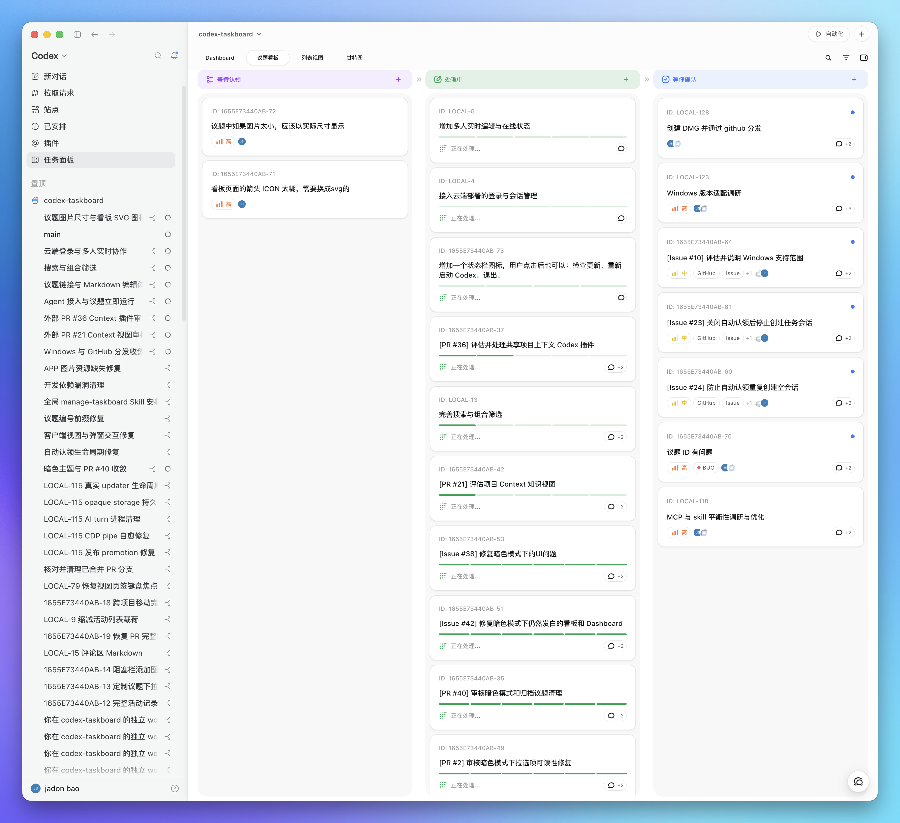

[English](README.md) | [简体中文](README.zh-CN.md)

# Broadcast

A local-first issue board that runs in a browser and can be embedded in Codex through the standalone CDP launcher or its injection script. The same HTTP API powers the React UI and the `broadcast` CLI used by the bundled Codex Skill.



## Requirements

- [pixi](https://pixi.prefix.dev) 0.76 or newer. `pixi.toml` pins Rust 1.100, Node.js 26 and pnpm 12, and `pixi run` installs them on first use. No rustup, nvm or global npm packages are needed.
- macOS App and DMG builds: Xcode Command Line Tools.
- Windows NSIS builds: the Microsoft Store Codex App and Visual Studio Build Tools with the C++ workload and Windows SDK.
- Ubuntu 24.04 packages: the WebKitGTK build packages listed under [Linux App](#linux-app-ubuntu-2404-x64-packages).

## Run locally

```bash
pixi run start
```

This builds the web UI and runs the Rust server. Open <http://127.0.0.1:47823>. The SQLite database is stored at `.data/broadcast.sqlite`.

For development with live frontend reload:

```bash
pixi run dev
```

The Vite UI runs at <http://127.0.0.1:5173> and proxies API requests to the Rust server on <http://127.0.0.1:47823>.

## Use the CLI

Build it and run it from the project:

```bash
pixi run build-native

target/debug/broadcast project create \
  --id my-project \
  --name "My project" \
  --workspace-path /absolute/path/to/repository

target/debug/broadcast issue create \
  --project my-project \
  --title "Implement the next slice" \
  --status todo \
  --priority high \
  --labels product,mvp
```

Run `pixi run cargo install --locked --path crates/cli` if you want `broadcast` on your shell path (`~/.cargo/bin`). Without a runtime descriptor the CLI talks to `http://127.0.0.1:47823`. Set `BROADCAST_URL` to point the CLI at another local or LAN service. Cloud deployments are configured through the **loopback companion** (device-local loopback service for auth and path mapping—not a chat persona) with `broadcast cloud login`.

## Install the Codex Skill

Copy or symlink `skills/manage-broadcast` into the Codex skills directory, then start a new Codex task:

```bash
ln -s /absolute/path/to/broadcast/skills/manage-broadcast \
  ~/.agents/skills/manage-broadcast
```

The desktop app keeps this same directory synchronized with its bundled Skill. The Skill teaches Codex to inspect an issue, move it to `in_progress`, use optimistic versions, verify the work, and then move it to `in_review`; it moves the issue to `done` only after the user explicitly confirms acceptance or asks to mark it complete.

## Embed in Codex

The desktop app embeds Broadcast in Codex. It runs the Broadcast server in-process and starts or reuses Codex with a CDP port, then injects the sidebar entry; the injection script is compiled into the launcher. There is no separate injector command.

### macOS App: open and inject without a terminal

For Tauri development, run:

```bash
pixi run install-js
pixi run pnpm app:dev
```

To build the local universal App and DMG, run the build in the `macos-release` environment, which adds the `x86_64-apple-darwin` standard library:

```bash
pixi run install-js
pixi run -e macos-release pnpm app:build
```

Open `target/universal-apple-darwin/release/bundle/macos/Broadcast.app` from Finder. The DMG is in `target/universal-apple-darwin/release/bundle/dmg/`. If you only want the stable App, download the current DMG from [GitHub Releases](https://github.com/iinoshirozheng/broadcast/releases/latest).

The App runs the Broadcast service in-process and contains the built web UI, the Skill, and the `broadcast` CLI with its wrapper. It starts the service, reuses an open Codex with a reachable CDP renderer, opens Broadcast in the native browser panel of an ordinary Codex without CDP, or launches the official Codex app when no Codex is open. It waits for the renderer, injects the sidebar entry when CDP is available, and opens the panel without showing a terminal window. The App can be copied away from this checkout; the target Mac only needs the official Codex app and does not need this repository, Node.js, or a separate Codex CLI installation. Broadcast data is stored in `~/Library/Application Support/Broadcast`, and launcher output is written to `~/Library/Logs/Broadcast/broadcast-launcher.log`.

### Linux App: Ubuntu 24.04 x64 packages

The first Linux desktop release supports Ubuntu 24.04 LTS on x64 only. Install the official ChatGPT desktop `.deb` first and confirm that `chatgpt` opens it. Then download either the Broadcast `.deb` or `.AppImage` from [GitHub Releases](https://github.com/iinoshirozheng/broadcast/releases/latest). Replace `<file>` below with the downloaded filename.

Install the `.deb` package:

```bash
sudo apt install ./<file>.deb
```

Or run the AppImage:

```bash
chmod +x ./<file>.AppImage
./<file>.AppImage
```

To build both packages on Ubuntu 24.04 x64, install the WebKitGTK build packages, then run the build:

```bash
sudo apt-get install -y build-essential curl file libayatana-appindicator3-dev \
  librsvg2-dev libssl-dev libwebkit2gtk-4.1-dev libxdo-dev patchelf wget
pixi run install-js
pixi run pnpm app:build:linux:x64
```

This first release does not support ARM64, Fedora, RPM packages, or other Linux distributions.

### Windows code signing

For official Windows releases after the application is approved: **Free code signing provided by [SignPath.io](https://signpath.io/), certificate by [SignPath Foundation](https://signpath.org/).** Current Windows CI artifacts remain unsigned until that approval. See the [Code signing policy](docs/code-signing-policy.md), [Privacy policy](PRIVACY.md), and [Windows uninstall instructions](docs/windows-uninstall.md).

The local build uses ad-hoc code signing for direct verification. A public macOS download still needs Developer ID signing and Apple notarization.

### Windows App: tray launcher and bundled Broadcast

Install the official Codex App from the Microsoft Store. To build the current-user NSIS installer on Windows x64, run:

```powershell
pixi run install-js
pixi run pnpm app:build:windows
```

The installer is written to `target/x86_64-pc-windows-msvc/release/bundle/nsis/`. It installs a tray launcher that runs the Broadcast service in-process, the built web UI, the Skill, and `broadcast.cmd` with the `broadcast` CLI. Broadcast data is stored in `%APPDATA%\Broadcast`; logs are stored in `%LOCALAPPDATA%\Broadcast\Logs`; the Skill is copied to `%USERPROFILE%\.agents\skills\manage-broadcast`.

Windows CI artifacts are intentionally unsigned and do not auto-update. Review [the code-signing policy](docs/code-signing-policy.md) before distributing a build. See [Windows uninstall](docs/windows-uninstall.md) for retained-data behavior.

Codex 26.715.52143 ships a renderer CSP that blocks arbitrary HTTP iframes. The launcher therefore enables CDP CSP bypass, reloads that renderer once, installs the document-start script, and waits until the Broadcast OOPIF is actually loaded. CDP is unauthenticated to other processes on the same machine, so only run trusted local code while the launcher is active.

The script adds a Broadcast entry to the Codex sidebar and renders the iframe across Codex's complete main workspace, including the contextual titlebar area so Broadcast's own header does not leave an empty strip. That full rectangular header is placed above Electron's draggable layer and marked `no-drag`; because the native contextual actions are suppressed while Broadcast is active, its own actions use their normal edge padding without an artificial right-side gap. The native sidebar stays mounted, while the previous page selection and contextual header are temporarily suppressed; choosing another Codex page restores them.

“在对话中打开” selects the corresponding native Codex project when one is available and opens an unsent native composer with an `e-broadcast` instruction and the issue's actual identifier. The installed Skill is selected implicitly from that instruction, so the composer does not add a `$manage-broadcast` mention. A conversation is attributed only after it actually processes the issue: `broadcast` reads Codex's `CODEX_THREAD_ID` and records that ID on the issue or comment mutation. Recorded IDs are clickable through Codex's native route bridge. Each issue can bind either one Git branch or one worktree; the options are scanned from the selected Codex project's repository instead of being typed by hand. The integration uses Codex's existing project, composer, and route markers; it does not patch React, replace `fetch`, load private chunks, or edit Codex data files.

To use a different UI origin, set `window.__BROADCAST_URL__` before the user script runs.

## Configuration

| Variable | Default | Purpose |
| --- | --- | --- |
| `BROADCAST_HOST` | `0.0.0.0` | HTTP bind address; use `127.0.0.1` to disable LAN access |
| `BROADCAST_PORT` | `47823` | Local HTTP port |
| `BROADCAST_TRUSTED_ORIGINS` | unset | Comma-separated exact HTTPS origins allowed through a loopback reverse tunnel |
| `BROADCAST_DATA_DIR` | `.data` | SQLite data directory |
| `BROADCAST_URL` | `http://127.0.0.1:47823` | CLI API origin |

The server prints both the local URL and the available LAN URLs. Teammates on the same trusted network can open one of those LAN URLs and use the same broadcast service. Task, comment, and attachment changes are broadcast to every open client through server-sent events; reconnecting clients perform a full refresh so changes made while disconnected are not missed. A teammate using `broadcast` can point it at the shared service with `BROADCAST_URL=http://<host-ip>:47823`.

LAN mode has no account authentication: anyone on the trusted local network who can reach the URL can read and write the broadcast. Public internet and cloud deployment require an authenticated deployment boundary.

For a reverse tunnel that connects to the local listener, set `BROADCAST_TRUSTED_ORIGINS` to the tunnel's public HTTPS origin, for example `https://board.example.test`. Multiple origins are comma-separated. The variable cannot be empty, and duplicate origins (including normalized forms such as a trailing slash or default HTTPS port) are rejected at startup. Entries must otherwise be exact HTTPS origins; paths, queries, fragments, credentials, and wildcards are rejected. A reverse proxy or tunnel can preserve that public `Host`: Broadcast derives its canonical HTTPS origin and requires an exact configured match. If the browser supplies an `Origin`, that header is validated independently; the proxy must preserve it rather than fabricate one. Forwarded headers are not used for either decision. Configured public hosts and trusted origins can use ordinary Broadcast HTTP and realtime endpoints, but device-local capability routes remain unavailable even though the tunnel socket is loopback. Requests using only direct local or private-LAN hosts and origins keep their existing behavior.

## Share through Cloudflare

For two trusted collaborators, the broadcast can run on Cloudflare with Worker Static Assets and API routes, D1 as the authoritative business database, and a private R2 bucket for attachments. The deployment uses HTTPS Basic Authentication with a shared password and refreshes open boards after a global revision changes.

Each device keeps its own project checkout mapping and continues to use a local companion for Codex, Git/worktree, Skill, and MCP capabilities. Cloud mode never falls back to or double-writes the local SQLite database.

See [Cloud collaboration](docs/cloud-collaboration.md) for owner deployment, existing GitHub installation setup, password rotation, local path mapping, and the one-time local-data migration flow.

## Verify

```bash
pixi run check
```

This runs Clippy (native and wasm), TypeScript checking and Biome, then builds the server, CLI, web UI and cloud worker and runs the component tests and the HTTP, CLI, injection and cloud suites against those builds. `pixi run test-e2e` runs the Playwright suite and `pixi run fmt` formats Rust and JavaScript.

## Task Markdown

Task descriptions and comments support GFM, including tables and task lists. Fenced `mermaid` blocks are rendered as read-only diagrams after the viewer loads; the diagram source remains available when rendering fails. Markdown HTML comments, such as `<!-- trace-analysis:v1 ... -->`, are hidden from the rendered document. Raw HTML is not enabled.

## Acknowledgements

Thanks to [Lingshan21](https://github.com/Lingshan21) for:

- The parent-based project completion proposal and initial implementation in [#371](https://github.com/iinoshirozheng/broadcast/pull/371), which weighted top-level parent issues equally regardless of how many children each had.
- The priority organization proposal and initial implementation in [#372](https://github.com/iinoshirozheng/broadcast/pull/372). The final board sorting controls were adapted to the maintainer's requirements instead of adopting the proposed priority swimlanes.
