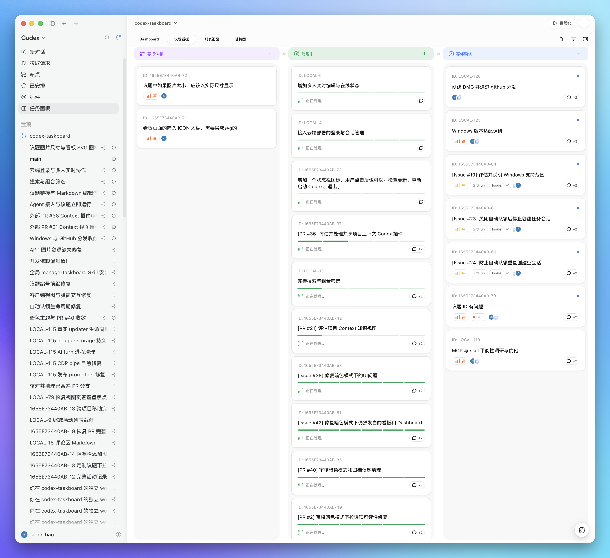

[English](README.md) | [简体中文](README.zh-CN.md)

# Broadcast

一个让人和 Agent 一起分工的议题面板，在浏览器中运行。同一套 HTTP API 为 React UI、随附 Skill 使用的 `broadcast` CLI，以及在你本机用 Claude Code 或 Codex 处理委派议题的 runner 提供支持。



## 系统要求

- [pixi](https://pixi.prefix.dev) 0.76 或更高版本。`pixi.toml` 固定了 Rust 1.100、Node.js 26 和 pnpm 12，`pixi run` 首次运行时会自动安装。不需要 rustup、nvm 或全局 npm 包。

## 本地运行

```bash
pixi run start
```

该命令会构建 Web UI 并运行 Rust 服务器。打开 <http://127.0.0.1:47823>。SQLite 数据库存储在 `.data/broadcast.sqlite`。

如需在前端实时重载模式下开发：

```bash
pixi run dev
```

Vite UI 运行在 <http://127.0.0.1:5173>，并将 API 请求代理到 <http://127.0.0.1:47823> 上的 Rust 服务器。

## 使用 CLI

在项目中运行：

```bash
pixi run build-native

target/debug/broadcast project create \
  --id my-project \
  --name "My project" \
  --workspace-path /absolute/path/to/repository

target/debug/broadcast issue create \
  --project my-project \
  --title "Implement the next slice" \
  --status todo \
  --priority high \
  --labels product,mvp
```

运行 `pixi run cargo install --locked --path crates/cli`，即可在 shell 路径（`~/.cargo/bin`）中使用 `broadcast`。CLI 连接 `http://127.0.0.1:47823`；设置 `BROADCAST_URL` 可指向另一个服务。

## 安装 Skill

将 `skills/manage-broadcast` 复制或符号链接到 Agent 的 Skill 目录（Claude Code 为 `~/.claude/skills`，Codex 为 `~/.agents/skills`），然后开启新对话：

```bash
ln -s /absolute/path/to/broadcast/skills/manage-broadcast \
  ~/.claude/skills/manage-broadcast
```

该 Skill 会指导 Agent 检查议题，将其移到 `in_progress`，使用乐观版本控制，验证工作，然后将其移到 `in_review`；只有在用户明确确认接受或要求将议题标记为完成后，才会将议题移到 `done`。议题详情的「复制 Agent 指令」按钮会复制一段在该议题上启动此流程的指令。

## 委派给 Agent

把议题指派给 Claude Agent 或 Codex Agent 并设为 `todo`，或在评论中提及 `@claude` 或 `@codex`，本机的 runner 就会接手：

```bash
broadcast runner claude --cwd /absolute/path/to/repository
broadcast runner codex --cwd /absolute/path/to/repository
```

runner 会认领议题，用 Agent CLI 自己的登录在该目录运行 `claude -p` 或 `codex exec`，把回答发为评论，然后将议题移到 `in_review`（Agent 失败时移到 `blocked`）。之后再次提及会接续同一个会话。Broadcast 永远不会收到你的 Agent 凭据。议题等待的 runner 不在线时，议题详情会显示提示。

## 配置

| 变量 | 默认值 | 用途 |
| --- | --- | --- |
| `BROADCAST_HOST` | `0.0.0.0` | HTTP 绑定地址；使用 `127.0.0.1` 可禁用局域网访问 |
| `BROADCAST_PORT` | `47823` | 本地 HTTP 端口 |
| `BROADCAST_DATA_DIR` | `.data` | SQLite 数据目录 |
| `BROADCAST_URL` | `http://127.0.0.1:47823` | CLI API 源地址 |

服务器会输出本地 URL 和可用的局域网 URL。同一受信任网络中的协作者可以打开其中一个局域网 URL，并使用同一个 Broadcast 服务。任务、评论和附件变化通过服务器发送事件广播到所有打开的客户端；客户端重连后会执行完整刷新，因此不会遗漏断开连接期间发生的变化。使用 `broadcast` 的协作者可以通过 `BROADCAST_URL=http://<host-ip>:47823` 指向共享服务。

局域网模式没有账户身份验证：受信任本地网络中任何能访问该 URL 的人都可以读取和写入面板。没有经过身份验证的边界时，请勿将它暴露到公网。

## 验证

```bash
pixi run check
```

该命令会运行 Clippy、TypeScript 检查和 Biome，然后构建服务器、CLI 和 Web UI，并运行 Rust 测试，再针对这些构建运行 Web 测试套件。`pixi run test-e2e` 运行 Playwright 测试，`pixi run fmt` 格式化 Rust 和 JavaScript。

## 议题 Markdown

议题描述和评论支持 GFM，包括表格和任务列表。`mermaid` 围栏代码块会在查看器加载后渲染成只读图；渲染失败时仍可阅读原始图表源码。Markdown HTML 注释（例如 `<!-- trace-analysis:v1 ... -->`）不会出现在渲染后的正文中，且不会启用原始 HTML。
